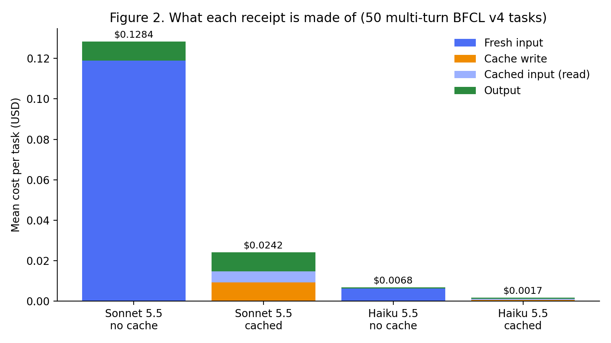
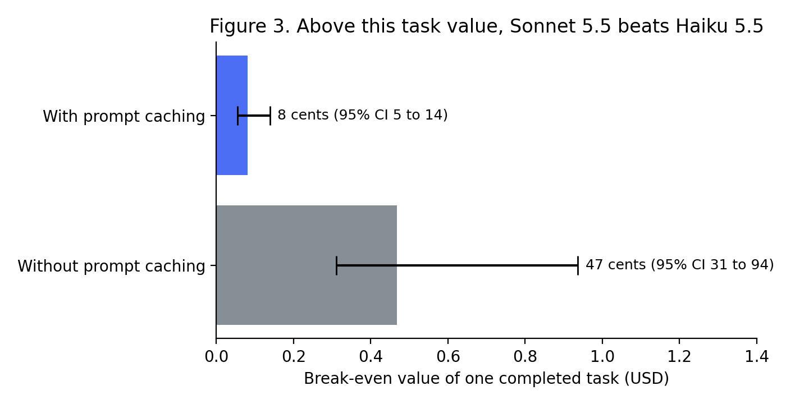

# agent-receipts

**Itemized receipts for LLM agent tasks, and what they say about which model to run.**

This repository is the open harness and data behind the article *"Is Your Agent's Task Worth a Dime? How Prompt Caching Changed Which Model We Should Run"* (submitted to InfoQ). It runs real multi-turn tool-calling agents, prices every model call from the provider's own usage fields, and writes one **receipt line per step**: fresh input, cache write, cache read, output, and whether the step's tool call failed.

Every number in the article can be recomputed from the logs in this repo with no API key and no spend:

```bash
pip install -r requirements.txt
python -m pytest -q tests          # the ledger reproduces the harness's per-step bill exactly
python analysis/reproduce.py       # every article number -> results/article_numbers.json
python analysis/figures.py         # Figures 2 and 3 -> results/
```

## Headline results

50 multi-turn tasks from the Berkeley Function Calling Leaderboard (BFCL) v4, real tool execution on BFCL's simulators, Claude Sonnet 5.5 vs Claude Haiku 5.5, list prices verified 2026-10-14. Success rates are shown with 95% Wilson intervals.

| Configuration | Success | Cost per task | Cost per successful task |
|---|---|---|---|
| Sonnet 5.5, no cache | 84% [71, 92] | $0.1284 | $0.1529 |
| Sonnet 5.5, cached | 86% [74, 93] | $0.0242 | $0.0281 |
| Haiku 5.5, no cache | 58% [44, 71] | $0.0068 | $0.0117 |
| Haiku 5.5, cached | 58% [44, 71] | $0.0017 | $0.0030 |

1. **Cost per success picks the model that fails 42% of tasks.** Cached Haiku is 9x cheaper per success.
2. **Break-even task value** V* = (extra cost per task) / (extra success rate). If one completed task is worth more than V*, run the frontier model.
3. **Prompt caching moves V* from $0.47 (95% CI $0.31 to $0.94) to $0.08 ($0.055 to $0.138).** Caching removes most of the frontier model's re-read context and leaves the quality gap in place. Comparing cached Sonnet against uncached Haiku gives $0.06.
4. **On single calls the small model wins outright:** 91.3% vs 89.8% success at $0.00019 vs $0.00360 per task (150 tasks, 3 runs).
5. **Re-priced from the same logs** (re-pricing the uncached logs reproduces their recorded cost exactly):
   - A cache that is marked but always misses costs $0.158 per task: 6.5x a working cache, and 23% more than no cache.
   - A cold-cache handoff from Haiku to Sonnet at the first tool error (17 of 50 tasks, median 5,847 tokens of history) costs $0.0146, which is 61% of an entire cached Sonnet task.




## What a receipt looks like

`python analysis/reproduce.py` prints this receipt for task `multi_turn_base_56` (a three-turn road-trip task; Sonnet 5.5, cached, succeeded). Steps 7 and 8 are tool calls that errored, and they cost 22% of the task.

```
step turn kind     fresh_in cache_read cache_write output      cost
   0    0 act             4       4010         127    137   0.00210
   1    0 act             2       4137         236     77   0.00178
   ...
   7    2 failed          4       4880          85    176   0.00247
   8    2 failed          2       4965         316     74   0.00203
   ...
  11    2 final           2       5485          94    137   0.00216
total 0.02052 USD, success=True
```

## Use it on your own agent

```python
from receipts import Receipt, break_even, cache_misses

r = Receipt(task_id="ticket-4821", config="sonnet-cached")
response = client.messages.create(...)                     # your agent loop
r.add(step=0, kind="act", model="claude-sonnet-5-5", usage=response.usage.model_dump())
...
r.success = grader(...)                                    # your own success label

v_star, (lo, hi) = break_even(frontier_receipts, small_receipts)   # dicts of task_id -> Receipt
alerts = cache_misses(r)                                   # steps that read nothing from cache
```

`receipts/ledger.py` takes the provider's field names (`cache_creation_input_tokens`, `cache_read_input_tokens`) or the harness log's names. Prices live in `harness/pricing_oct2026.json`; edit them to re-price at your own rates.

## Repository layout

```
receipts/      the ledger (Receipt, Line), break_even(), cache_misses()
analysis/      reproduce.py (all article numbers), figures.py
results/       article_numbers.json and the figures, regenerated by analysis/
tests/         ledger vs harness bill, break-even formula, cache check
harness/       the experiment harness, task samples, prices and raw run logs
  run_experiment.py      single-turn BFCL v4 (150 tasks, tools not executed, AST-graded)
  run_multiturn.py       multi-turn BFCL v4 agent loop on real simulators
  bfcl_mt/, bfcl_ast_checker.py   vendored from BFCL (Apache 2.0, see NOTICE)
  runs/, runs_mt/        raw per-task and per-step logs from 2026-10-14
```

## Method

- **Workload.** BFCL v4 at gorilla commit `6ea5797`, seed 42. Single-turn: 150 tasks, 30 from each of five categories. Multi-turn: 50 of the 200 `multi_turn_base` tasks, across eight simulated domains (file system, messaging, posting, ticketing, math, trading, travel, vehicle control), with 1 to 6 user turns and 5.8 ground-truth calls on average. Tool errors are returned to the model, and BFCL's state and response checks grade every turn.
- **Configurations.** Sonnet 5.5 and Haiku 5.5, with and without prompt caching (5-minute ephemeral breakpoints), and low vs medium reasoning effort. The cached Haiku configuration also has a 5-call tool budget. All share one system prompt, `max_tokens` 16,000, and tool choice auto. See `CONFIGS` in `harness/run_experiment.py`.
- **Prices.** `harness/pricing_oct2026.json`, verified against Anthropic's pricing page on 2026-10-14. Haiku 5.5 is priced per request by prompt length (all prompts here are under 100K tokens). Every cost is the provider-reported token count for that call multiplied by these list prices; nothing here is reconciled against invoices.
- **Statistics.** Wilson intervals, an exact McNemar test on paired task outcomes (Sonnet-only vs Haiku-only successes: 14 vs 1 uncached, p = 0.001; 14 vs 0 cached), and a 10,000-sample paired bootstrap over tasks for V*.

### Re-running the experiment (costs money)

```bash
export ANTHROPIC_API_KEY=...        # from your environment, never committed
cd harness
python run_experiment.py --all --dry-run                 # zero spend
python run_multiturn.py --dry-run --max-tasks 3          # zero spend
python run_experiment.py --all --max-tasks 150 --max-spend-usd 5
python run_multiturn.py --configs frontier frontier_cache small small_cache_budget --max-spend-usd 25
```

The published multi-turn run cost $14.81 in total.

### Notes on the data

- The multi-turn run stopped on an API credit limit during `frontier_low`. 42 of its 50 rows were recovered from `console.log` (marked `source` in the row) and the other 8 were finished with `--resume`. The recovered rows have no per-step records, so they appear only in task-level numbers.
- Smoke and dry runs were excluded. Every full run is included.

## Limits

This is 50 multi-turn tasks, one rollout each, one model family and one benchmark. The direction of the effect is clear; the exact break-even for your agent is not. Measure your own success rates and costs, and treat the intervals as wide. Task value is a single number per workload, and latency is not priced.

## Related work

Cost-of-Pass ([arXiv 2504.13359](https://arxiv.org/abs/2504.13359)); AI Agents That Matter ([arXiv 2407.01502](https://arxiv.org/abs/2407.01502)); Holistic Agent Leaderboard ([arXiv 2510.11977](https://arxiv.org/abs/2510.11977)); Don't Break the Cache ([arXiv 2601.06007](https://arxiv.org/abs/2601.06007)); Whose Turn Is It? ([arXiv 2610.19292](https://arxiv.org/abs/2610.19292)); The Handoff Tax ([arXiv 2608.24358](https://arxiv.org/abs/2608.24358)); Economic Evaluation of LLMs ([arXiv 2507.03834](https://arxiv.org/abs/2507.03834)).

The harness was first built for a short academic paper on monetary cost models for agent workflows, which is under review. This repository adds the receipt ledger, the break-even analysis, the re-pricing studies and the figures.

## Author

Mehek Mandal: founder of [Litos](https://trylitos.com) and [Galore](https://trygalore.com), and co-founder of Traeco.

## License

MIT for original code (`LICENSE`). The vendored BFCL material is Apache 2.0 (`NOTICE`, `LICENSE-APACHE-2.0.txt`).
